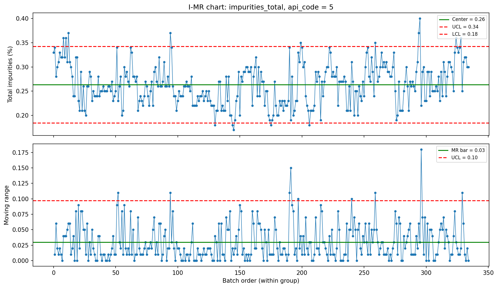
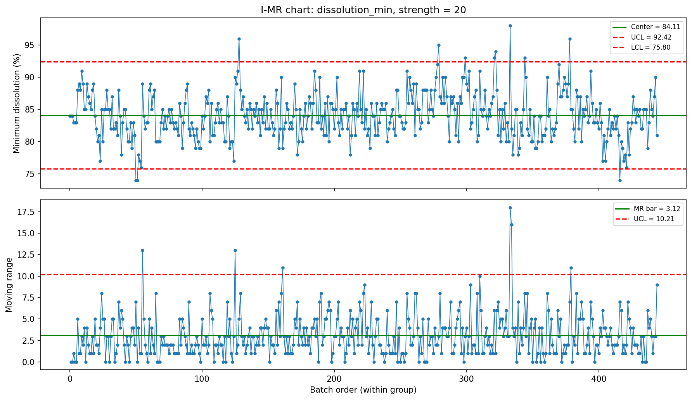
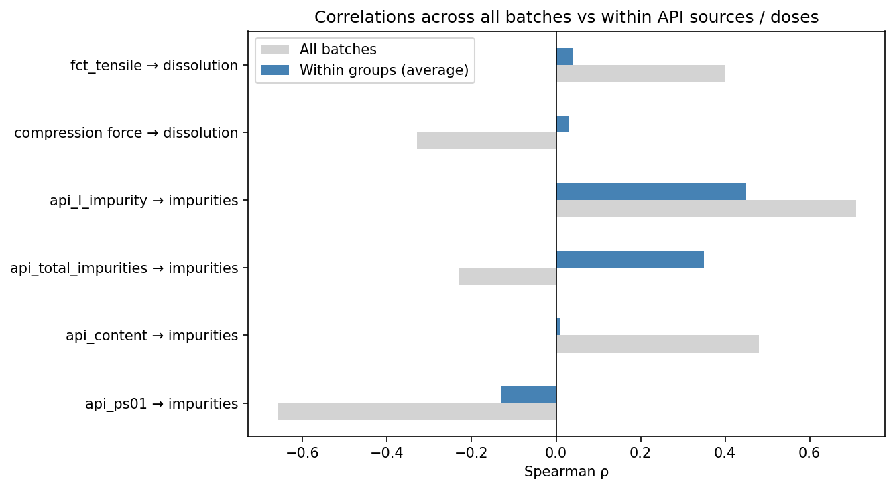
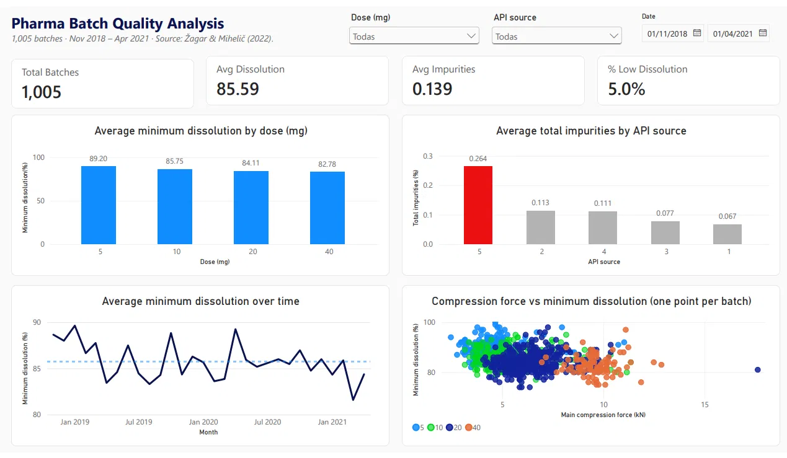

# Pharma Batch Quality Analysis

Analysis of **1,005 production batches** of a cholesterol-lowering drug (film-coated tablets) to understand what drives two critical quality attributes: **dissolution** and **impurities**. The project combines statistical process control and correlation analysis to identify which raw material and process variables the Quality department should monitor.

**Tools:** Python (pandas, matplotlib, seaborn), SQL (SQLite), Google Colab, Power BI

---

## Business context

In pharmaceutical manufacturing, every batch must meet quality specifications before release. Two key attributes are:
- **Minimum dissolution:** % of the active ingredient (API) released in 30 minutes. Low values mean the patient may not absorb the correct dose.
- **Total impurities:** % of impurities in the final tablet. High values affect product safety.

Quality results arrive from the laboratory after production, so knowing which **incoming material** and **process** variables are related to quality helps anticipate risky batches before they are produced.

---

## Dataset

- **Source:** Žagar, J. & Mihelič, J. (2022). *Big data collection in pharmaceutical manufacturing and its use for product quality predictions.* Scientific Data, 9(1), 99. https://doi.org/10.1038/s41597-022-01203-x
- **Data:** [figshare collection](https://figshare.com/collections/Cholessterol-Lowering_Drug_Process_and_Quality_Data/5645578)
- **Files used:**

| Table | Rows | Description |
|---|---|---|
| `Laboratory` | 1,005 | Raw material analysis, intermediate and final product quality per batch |
| `Process` | 1,005 | Tablet press data summarized per batch (compression force, speed, waste, etc.) |
| `Normalization` | 25 | Batch size normalization factor per product code |

---

## Business questions

| # | Question | Method |
|---|---|---|
| 1 | How stable is the process over time and across products in terms of minimum dissolution and total impurities? | I-MR control charts by dose and by API source; RSD by dose |
| 2 | Which raw material characteristics are most strongly related to minimum dissolution and total impurities? | Spearman correlation across all batches and within each API source |
| 3 | Are the compression parameters related to minimum dissolution and total impurities? | Spearman correlation across all batches and within each dose |
| 4 | Which input and process variables should be monitored by the Quality department? | Prioritization based on relationships that hold within API sources and doses |

---

## Project workflow

| Notebook | Content |
|---|---|
| `01_data_understanding_pharma.ipynb` | Structure, data types, missing values, consistency checks and data dictionary |
| `02_sql_layer_pharma.ipynb` | SQL queries (aggregations and joins) as a first approach to the business questions |
| `03_data_cleaning_pharma.ipynb` | Cleaning of the three tables, merge and export of the clean dataset |
| `04_analysis_pharma.ipynb` | Control charts, correlation analysis and recommendations |

---

## Key findings

### 1. Impurities depend on the API supplier
Impurity control charts by dose showed **25–48% of batches out of control** with clear level shifts. The cause was the **mix of API suppliers**: API source 5 produces tablets with about **3 times more impurities** (~0.26% vs ~0.07–0.11%). When charts are built per supplier, source 5 behaves as a stable process at a higher level.



### 2. Dissolution depends on the dose, not on raw materials or compression
Dissolution decreases as the dose increases (89.2% at 5 mg vs 82.8% at 40 mg). Compression force, fill depth and tensile strength seemed related to dissolution (ρ = −0.33 to +0.40), but **these correlations disappear within each dose**: the apparent effect came from the dose itself. 20 mg is the least stable dose (2.47% of batches out of control).



### 3. Only API impurities are truly related to final impurities
Strong correlations with API particle size (ρ = −0.66) and API content (ρ = 0.48) disappear within each supplier. Only **API impurity L** (ρ = 0.34–0.56) and **API total impurities** (ρ = 0.32–0.37) hold within each source. API total impurities even showed a **Simpson's paradox**: negative across all batches, positive within each supplier.




---
## Dashboard

Interactive Power BI dashboard with filters by dose, API source and date.




---

## Recommendations

1. **Monitor impurities by API supplier** and review source 5 specifications with Purchasing.
2. **Set internal acceptance limits** for API impurity L and API total impurities at incoming inspection.
3. **Build control charts by supplier (impurities) and by dose (dissolution)**, not for all batches together.
4. **Focus dissolution monitoring on 20 mg and 40 mg**, and investigate special causes in 20 mg.
5. **Do not adjust compression parameters to improve dissolution**: no evidence of an effect within doses.
6. **Improve data recording**: specification limits, complete API impurity L results, consistent missing value format and review of hardness measurements.

---

## Data quality issues found

- Missing values stored as **blank spaces**, hiding 563 missing values (not 36) in `Laboratory`.
- **API impurity L missing in 77%** of batches from the main supplier (source 3).
- **Hardness columns inconsistent**: average outside the min–max range in 479 and 337 batches (excluded; tensile strength used instead).
- **Batch size error** for 2 product codes (4,800,000 vs 480,000).
- Duplicated quality columns in `Process` and month names in Slovenian (`maj`, `avg`, `okt`).

---

## Limitations

- Correlation does not imply causation.
- Specification limits are not reported, so process capability (Ppk) could not be calculated.
- Total impurities are concentrated at the quantification limit (0.05%), which limits control chart interpretation for some suppliers.

---

## Repository structure

```
pharma_batch_quality_analysis/
├── data/
│   ├── raw/              # original CSV files (download from figshare)
│   └── processed/        # pharma_clean.csv (README)
├── notebooks/            # 01–04 notebooks
├── sql/                  # exported SQL queries
├── reports/
│   └── figures/          # charts generated in notebook 04
├── requirements.txt
└── README.md
```

---

## How to reproduce

1. Download `Laboratory.csv`, `Process.csv` and `Normalization.csv` from the [figshare collection](https://figshare.com/collections/Cholessterol-Lowering_Drug_Process_and_Quality_Data/5645578) and place them in `data/raw/`.
2. Install dependencies: `pip install -r requirements.txt`
3. Run the notebooks in order (01 → 04). They were built in Google Colab; update the paths at the top of each notebook if running locally.

---

## Author

**Diego Enrique Cortés Durón**: Biochemical Engineer | Lean Six Sigma Black Belt | Data Analyst
[LinkedIn](www.linkedin.com/in/diego-enrique-cortés-durón-216605237) · [GitHub](https://github.com/diegocortes30)
